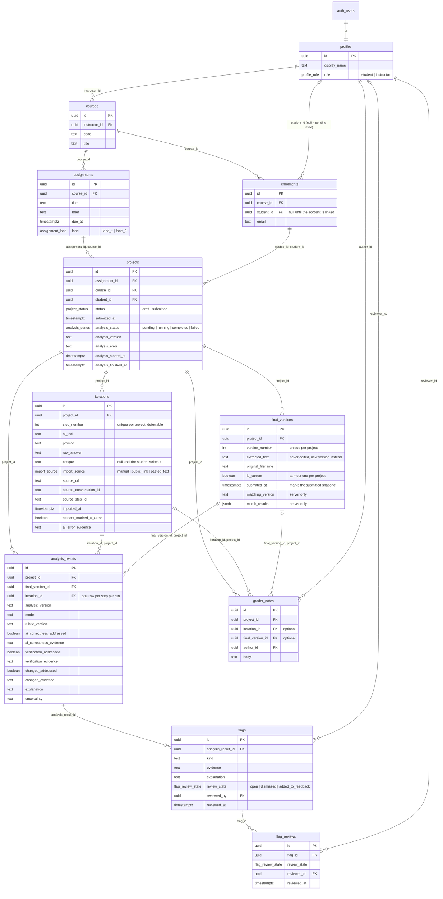
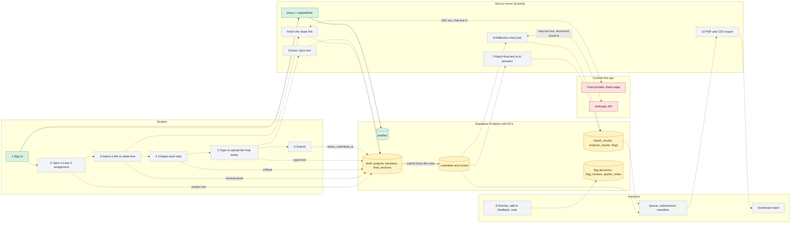

# Architecture

This is what the database and app really do today, and what we still haven't built. We checked the ERD against the migrations in `supabase/migrations`. The data flow marks each step as working, database-ready or planned.

| Label | Meaning |
| --- | --- |
| Working | In the repo, and the app uses it. |
| Database-ready | The schema, RLS and triggers already enforce it and have SQL tests, but no app code calls it yet. |
| Planned | Not built. The issue that owns it is linked. |
| Prototype | A screen from `design/` or `src/app` that shows fictional data. |

## Schema (ERD)

We only list the columns that matter, so `created_at` is left out. Composite foreign keys like `projects (assignment_id, course_id)` keep rows in the same course or project.

Things the diagram can't show:

- **Lane 2 only.** A trigger blocks a project on a Lane 1 assignment. An assignment that already has projects can't move to Lane 1.
- **One project per student and assignment.** Opening an assignment again has to reuse the same row.
- **Steps keep their ID.** Reordering only changes `step_number`. The unique constraint is deferrable, so two steps can swap inside one transaction.
- **Final text is never edited.** A trigger rejects changes to the text. An edit saves a new version and moves `is_current`.
- **Review history is automatic.** Changing a flag's decision appends a `flag_reviews` row, and that includes reopening a flag.
- **Deletes are restricted.** Deleting a project also deletes its steps, finals, analysis, flags, history and notes. Courses, assignments, enrolments and profiles that still have records can't be deleted.
- **Matching isn't a character count.** The old prompt and critique character model is gone. Match results live on `final_versions` with the matcher version that made them.

## Data flow

Solid arrows exist today. Dotted arrows are planned. Red boxes are outside the app. The numbers match the table below.

| # | Stage | Status | What happens |
| --- | --- | --- | --- |
| 1 | Sign in and role routing | Working | Password sign-in through Supabase Auth. `proxy.ts` only checks that a session cookie is there. `requireRole` checks the user with `auth.getUser()` and reads the role from `profiles`, never from user metadata. The plan said magic links, but we built passwords. |
| 2 | Open a Lane 2 assignment | Database-ready, [#19](https://github.com/DDarrenYe/DAYS-Capstone/issues/19) | A student can only insert a draft `projects` row for their own enrolment and a Lane 2 assignment. The unique key stops duplicates, so the app has to select before it inserts. |
| 3 | Import or manual entry | Database-ready, [#20](https://github.com/DDarrenYe/DAYS-Capstone/issues/20) | `iterations` stores the prompt, raw answer, tool and where it came from (`import_source`, source URL and IDs). A unique key on tool, conversation and step ID stops the same imported step being saved twice. Fetching a public link isn't built. |
| 4 | Critique | Database-ready, [#20](https://github.com/DDarrenYe/DAYS-Capstone/issues/20) | The three questions are only guidance in the UI. The answer is one `critique` text. It's null while an imported step waits, and can't be blank once saved. Marking an AI error needs evidence, and it only records what the student said. |
| 5 | Final essay | Database-ready, [#22](https://github.com/DDarrenYe/DAYS-Capstone/issues/22) | Every save is a new `final_versions` row. `.docx` extraction and the size and type checks will run on the server. |
| 6 | Atomic submission | Partly database-ready, [#23](https://github.com/DDarrenYe/DAYS-Capstone/issues/23) | While the project is a draft, a student sets `status` and `submitted_at`. After that, RLS and a trigger that locks the project row reject student writes to the project, its steps and its finals. A save that runs at the same time waits for the submit. We haven't built the completeness check, picking the submitted final or starting analysis. |
| 7 | Text matching | Planned, [#26](https://github.com/DDarrenYe/DAYS-Capstone/issues/26) | A deterministic matcher compares the final text with the logged AI answers on the server. It writes `match_results` and `matching_version`, and makes no outside call. |
| 8 | Reflection check | Tables ready, job planned, [#31](https://github.com/DDarrenYe/DAYS-Capstone/issues/31) [#32](https://github.com/DDarrenYe/DAYS-Capstone/issues/32) [#34](https://github.com/DDarrenYe/DAYS-Capstone/issues/34) | A server job sets `analysis_status`, calls Anthropic, validates the answer, and writes one `analysis_results` row per step plus any `flags`. A finished run with no flags is different from pending or failed. A new run keeps the old results and their reviews. |
| 9 | Grader decisions | Database-ready, [#33](https://github.com/DDarrenYe/DAYS-Capstone/issues/33) | An instructor of that course changes a flag's decision, reviewer and time, and a trigger appends it to `flag_reviews`. They can only add, edit and delete their own `grader_notes`. |
| 10 | Export | Planned, [#36](https://github.com/DDarrenYe/DAYS-Capstone/issues/36) | The server builds the PDF and CSV from the same submitted snapshot, matches and decisions the instructor sees. Notes only go in when the grader picks that. |

## Who can do what

The database enforces this for any client using the anon key and a user session. `service_role` is for trusted server code only. It skips RLS, so any route using it has to check `requireRole` and course ownership itself. Nothing in the app uses `service_role` or `getDb()` yet.

| Table | Student (own enrolled courses) | Instructor (own courses) | `service_role` |
| --- | --- | --- | --- |
| `profiles` | Read own row | Read own row | Read and write |
| `courses`, `assignments` | Read | Read, create their own course, add assignments to it | Read and write |
| `enrolments` | Read own row | Read the course, add students through `enrol_students` | Read and write |
| `projects` | Read own, create a Lane 2 draft, submit it, delete while draft | Read submitted projects | Read and write |
| `iterations` | Read own, write while draft | Read submitted projects | Read and write |
| `final_versions` (text columns) | Read own, write while draft | Read submitted projects | Read and write |
| `matching_version`, `match_results` | No access | No access | Read and write |
| `analysis_results` | No access | Read | Read and write |
| `flags` | No access | Read, change review columns only | Read and write |
| `flag_reviews` | No access | Read | Read and write |
| `grader_notes` | No access | Read, add, edit and delete own notes | Read and write |

Anonymous clients can't touch any table. Instructors can't change student text. Students can't read flags, analysis or notes.

## Text that leaves the app

Right now nothing does. We have no link fetcher, no `.docx` upload and no Anthropic client. Sign-in sends the email and password to Supabase, which runs locally in dev.

The plan adds two outside calls. Both run on the server, never in the browser.

| Call | What goes out | What comes back | Issue |
| --- | --- | --- | --- |
| Share-link import (step 3) | The URL the student pasted, sent to an allowlisted host | The public chat page | [#20](https://github.com/DDarrenYe/DAYS-Capstone/issues/20) |
| Reflection check (step 8, after submission) | Text from the submitted steps, sent to Anthropic | A validated, structured result | [#31](https://github.com/DDarrenYe/DAYS-Capstone/issues/31), [#32](https://github.com/DDarrenYe/DAYS-Capstone/issues/32) |

Matching and export stay inside the app. We haven't fixed what the reflection check sends. We should settle it in [#31](https://github.com/DDarrenYe/DAYS-Capstone/issues/31) and put it on the privacy page in [#25](https://github.com/DDarrenYe/DAYS-Capstone/issues/25). What we'd propose is submitted steps only (prompt, AI answer and critique), sent from a server job, with no names, emails, grader notes or review decisions. Whether any essay text goes too is still open. We can't control Anthropic's own retention, and the privacy page can't say that no text leaves the app.

## Prototype versus working

| Area | Today |
| --- | --- |
| Sign-in, sign-out, role routing | Working. Unit tests cover the proxy, account and credential helpers. |
| Schema, constraints, triggers, RLS and grants | Working and covered by `supabase/tests`. The app only reads `profiles` so far. |
| Seed data | Working, local only. `supabase/seed.sql` builds one course, eight accounts and eight example projects, listed in `supabase/README.md`. The pages don't show any of it yet, and `match_results` is left empty until the matcher exists. |
| Student assignments page | Prototype. Three hard-coded cards, and "Add steps" opens a placeholder. |
| My log, progress, privacy | Placeholders. No data and no consent text. |
| Instructor overview and essay plot | Prototype. Names and percentages are hard-coded from the mockups. The flags and reports pages are placeholders. |
| Import, critique, final essay, submit | Not built. The tables and locks are ready. |
| Matching, reflection check, grader decisions, export | Not built. The tables, versions and review history are ready. |

## What's still missing

- **Instructors can't read student names.** `profiles` only lets a user read their own row. The submissions table in [#28](https://github.com/DDarrenYe/DAYS-Capstone/issues/28) needs names, so we need a server read or a new policy.
- **The database doesn't check that a log is complete.** A student client can set `status = 'submitted'` on an empty draft. Only the lock after submitting is enforced. [#23](https://github.com/DDarrenYe/DAYS-Capstone/issues/23) should add the check, in a database function if we want direct writes rejected too.
- **Students can't read their own match results.** `match_results` is server-only, so the preview in [#22](https://github.com/DDarrenYe/DAYS-Capstone/issues/22) needs a server read or has to work the result out on request.
- **Flag decisions have no note column.** [#33](https://github.com/DDarrenYe/DAYS-Capstone/issues/33) mentions an optional note, but the review columns and `flag_reviews` don't store one.
- **Roles can't be changed from the app.** Instructors are promoted by a trusted administrator. Enrolling by email never changes a role, and an invitation is only linked to a confirmed student account.
